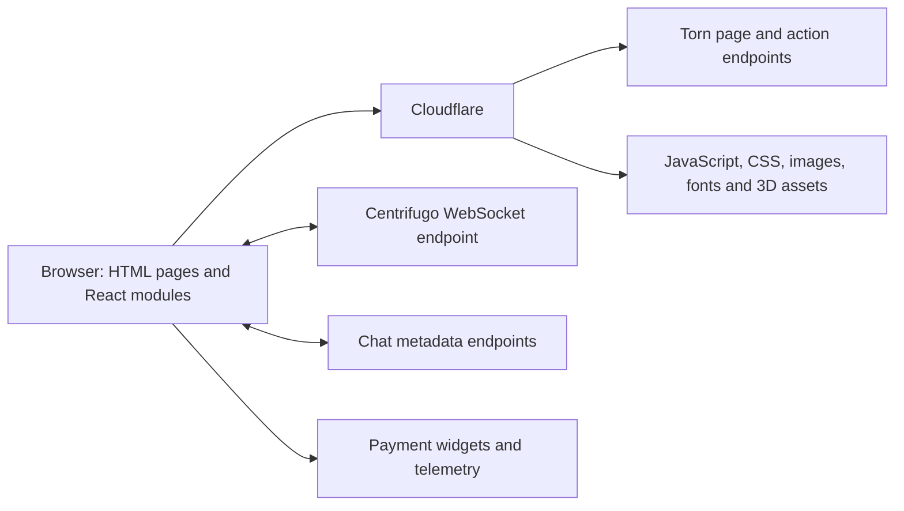

# Torn.com HAR analysis

The supplied capture provides a strong reference for the Torn screens explored in this session. It contains actual page HTML, most requested frontend assets, API response structures, and real-time messages. It supports a detailed interface reconstruction and an initial backend contract map. Torn's server implementation and complete game mechanics remain unknown.

Analysis date: 6 September 2026. Source: [www.torfn.com.har](C:/Users/user/.claude/RadixMedia/radix-media/RADIXSUB/mostaql_case/ZONE/www.torfn.com.har). Despite the filename, the recorded primary host is **www.torn.com**. The supplied file was inspected locally and left unchanged. Captured instructions were treated as document data. No captured endpoint, cookie, or token was replayed.

**Capture size and coverage**

| Measure | Verified result |
|---|---:|
| File size | 223,484,149 bytes, or 223.48 MB |
| Network entries | 7,403 |
| Distinct exact request URLs | 1,155 |
| Recorded hosts | 23 |
| Page records | 46 |
| Successful main-site HTML responses with bodies | 46 |
| Distinct successful screen routes after masking IDs | 24 |
| Entries containing response bodies | 2,225 |
| Exact request URLs with at least one captured body | 1,086 |
| Grouped main-site API operations | 52 groups across 666 calls |
| WebSocket records | 62, including 51 successful upgrade handshakes |
| WebSocket message records | 1,304 sent/received frames plus 11 error records |

Valid request starts span **5 September, 16:28:11 to 20:02:11 UTC**, equivalent to **20:28:11 to 00:02:11 Dubai time**, crossing into 6 September. The span is 3 hours 34 minutes; much of the later traffic is background activity. Eleven socket error records have invalid 1969 timestamps, and `page_46` has an invalid 1970 page timestamp. These are excluded from relevant chronology calculations. Its actual HTML response is still counted.

The 52 API groups are an analysis grouping by method, path, routing selectors, and selected body operations. They are not Torn's complete API inventory. Numeric IDs and non-routing query values are omitted; some finer distinctions therefore share a group.

**What the session actually covered**

Entry references below are one-based indices into `log.entries` in the source HAR.

| Area | Captured evidence | Important limitation |
|---|---|---|
| Global game shell | Header/sidebar bundles; user status, resource bars, timers, online presence, and news tickers. Sidebar data at entry 123; user state at 115. | Regeneration and entitlement rules are not fully established. |
| Profiles and gallery | Seven profile document loads, gallery HTML, profile data, image metadata, badges and interactions. Entries 12, 138, 260. | Gallery-specific JS/CSS bodies are missing. |
| City and shops | City map, territory geometry files, quick links, pharmacy, candy and clothes shop HTML. Entries 513, 654, 4993, 5573, 5856. | Browsing is captured; completed shop purchases are not established. |
| Item market | Categories, filtering, sorting, pagination, item searches, seller listings, and live market updates. Entries 390, 391, 6322, 6324. | No completed market purchase or settlement flow is established. |
| Points and donations | Point price history, refills/catalogue data, product lists, PayPal and Amazon Pay components. Entries 807, 923, 1408, 1410. | No completed refill, checkout, or payment confirmation is established. |
| Crimes | Crimes hub plus 27 `/crimesHubApi.php` calls covering `typeID` 1 through 13. Responses contain `DB.crimes`, `DB.user`, and time. Entry 1685. | These calls load crime data; crime execution and success formulas are not established. |
| Combat | Attack HTML, one initial attack-data request and 18 polling requests. Responses expose participants, equipment, ammunition, life and temporary effects. Entry 2569. | No complete attack execution/result sequence; one attack JS bundle lacks its body. |
| Missions and elimination | Missions HTML, competition state, teams, timers and elimination-channel publications. Entries 2755, 2107, 2113. | Mission acceptance/completion and all competition transitions are not established. |
| Factions | Creation screen, faction profile, candidate list, rankings and war data. Entries 3079, 3186, 3367, 3375. | Viewing the creation screen does not demonstrate faction creation. |
| Jobs | Job pages, job listing and seven interview-step requests returning HTML. Entries 4525, 4546 through 4583. | A complete employment lifecycle is not established. |
| Gym | Strength, defense, speed, dexterity, energy and gym classes from `getInitialGymInfo`. Entry 6504. | Actual training requests and stat-gain calculations are not captured. |
| Inventory and equipment | Inventory lists, item details, modifications, equipped loadouts, two GLB models and environment lighting. Entries 6305, 6309, 6372, 6829, 6843. | Complete equip/use/consume/trade mutations are not established. |
| Social and settings | Messages/forum HTML, chat metadata GET/PUT, friend/recent-contact lists, profile preferences, sidebar settings and dark-mode writes. Entries 1715, 2131, 3556, 3754, 3755. | Chat metadata persistence is captured; end-to-end message delivery is not established. |

**Architecture supported by the capture**

- **Hybrid frontend:** full-document routes with modular React/ReactDOM builds, alongside jQuery 1.8.2 and jQuery UI 1.9.1. The ReactDOM body contains version 19.2.0. Actual library bodies were inspected at entries 5713, 5744 and 5749; versions were not inferred solely from filenames.
- **Webpack modules:** runtime/vendor/app bundles for the shared shell and feature areas. Webpack markers occur in captured bodies at entries 3032, 3033 and 3034. There are 24 named `/builds/` directories, including the React runtime directory.
- **Page/action backend surface:** `.php` routes return HTML or JSON and dispatch using fields such as `sid`, `step` and `action`. Representative observed shapes include `categoryGroups` for market initialization and `stats`, `energy`, `gyms` for gym initialization. This exposes the external contract, not the deployed server code or database engine.
- **Centrifugo real-time transport:** `ws-centrifugo.torn.com/connection/websocket`, the Centrifuge client library, and decoded `connect`, `subscribe`, `unsubscribe` and `push` frames agree. Successful socket records include entries 131 and 261. Publications include item-market updates, elimination updates and one opaque private channel. The observed protocol shape matches the [Centrifugo client protocol](https://centrifugal.dev/docs/transports/client_protocol).
- **Maps and item rendering:** Leaflet 1.9.4, territory geometry, GLB models, an HDR environment and a Draco WASM decoder are present. These provide actual rendering assets and implementation clues.
- **Supporting services:** Sendbird references occur in chat bundles and metadata routes. Firebase client configuration loads are recorded, but they do not establish the application's database architecture. Sentry-style telemetry goes to `air.torn.com`; Google analytics, PayPal and Amazon Pay resources are also present.

Some JavaScript files reference source maps, but **no `.map` resource was requested in this capture**. Original unbundled source cannot be assumed available.

**Asset completeness after deduplication**

The following counts use exact request URLs on `www.torn.com`. Bodies can be recovered from any occurrence of a URL, including a later request in the session. Assets on Torn's separate image subdomains are outside this particular table.

| Asset class | Unique requested URLs | URLs with a captured body |
|---|---:|---:|
| JavaScript | 174 | 169 |
| CSS | 136 | 135 |
| Images | 408 | 408 |
| Fonts | 5 | 5 |
| GLB/HDR assets | 3 | 3 |
| WASM | 1 | 1 |
| **Total** | **727** | **721, or 99.2%** |

The six missing main-site asset bodies are:

| Asset | Entry |
|---|---:|
| `/builds/gallery/app.b75d6d0b6579e6f2.css` | 89 |
| `/builds/gallery/runtime.b2ea23a33983e664.js` | 90 |
| `/builds/gallery/vendors.e4a4b1daca2c2cef.js` | 91 |
| `/builds/gallery/app.0fef6fe2b95cc9ed.js` | 92 |
| Cloudflare challenge-platform script, variable path omitted | 1680 |
| `/builds/attack/attack.8d5c4d2e104562f6.js` | 2550 |

The broader inventory also identifies missing third-party reCAPTCHA assets and an analytics image response. A HAR body is not equivalent to a rendered screenshot: visual fidelity still requires rendering and comparing the relevant screens. No page scripts were executed during this analysis.

**Failures and performance**

| HTTP status | Entries | Interpretation |
|---|---:|---|
| 200 | 7,159 | HTTP response completed successfully; application outcomes still require inspecting the body. |
| 101 | 51 | WebSocket upgrades. |
| 204 | 32 | No-content responses. |
| 301 / 302 / 304 | 1 / 9 / 2 | Redirects and cache validation. |
| 503 | 34 | All are prefetch requests refused as ineligible by Cloudflare. |
| 404 | 4 | Two distinct Discord-hosted image URLs, each requested twice. |
| 0 | 111 | No HTTP status recorded; see the breakdown below. |

Every 503 has `cf-speculation-refused: prefetch refused: not eligible`. This is consistent with Cloudflare Speed Brain's documented handling of unsuccessful prefetches. These records do not demonstrate an origin outage. [Cloudflare documentation](https://developers.cloudflare.com/speed/optimization/content/speed-brain/)

Of the 111 status-zero entries, 91 concern the timer worker, 11 are WebSocket error placeholders and one is a reCAPTCHA worker. These 103 have no specific `_error` value, so their precise cause is unresolved. The remaining **eight have explicit network errors**: two connection timeouts and six DNS-resolution failures, at entries 7364-7371. They occur from **17:42:32 to 17:45:03 UTC**, or **21:42:32 to 21:45:03 Dubai time**. Successful API responses resume at entry 7372, at 17:45:14 UTC. The capture proves a temporary connectivity problem, but cannot locate its cause in the client, ISP, resolver, or hosting network.

Application state must be distinguished from HTTP status: entry 3756 returns HTTP 200 with `success: false` because the account has no faction mates. It is a useful empty-state example, not evidence that all 200 responses represent successful game actions.

Recorded timing and bandwidth findings:

- **Main HTML response duration:** median 195 ms; 95th percentile 615 ms; maximum 657 ms, across 46 successful responses.
- **Page load event:** median 759 ms; 95th percentile 3.84 seconds; maximum 4.97 seconds, across 43 usable page-timing records. Two page loads have no timing and the invalid 1970 page record is excluded. These are load-event timings, not LCP or interaction-readiness measurements.
- **Longest page load:** a profile on `page_22`. Its backdrop request, entry 3523, takes 4.55 seconds, including 4.40 seconds receiving data. It finishes about 3 ms before the page load event. This strongly implicates that asset in this particular load delay; it does not establish a site-wide bottleneck.
- **Recorded transfer total:** 38,957,437 bytes, or 38.96 MB, summing HAR `_transferSize`. There are 5,592 zero-transfer entries, consistent with substantial cache reuse and non-transfer records. The 223 MB HAR file size is not the session's network download volume.
- **Two Imgur GIFs dominate bandwidth:** entries 2425 and 2437 transfer 9.82 MB and 8.64 MB, together **47.4% of the recorded transfer total**. They are loaded on a profile page. User-supplied media is a material performance consideration for a similar game.

This is one browsing session with extensive cache reuse. It is not a cold-start benchmark or a current availability test.

**Sensitive material in the original**

The raw file contains 1,435 request Cookie headers, 451 response Set-Cookie headers, 192 `X-Torn-Session` response headers, and 10 `X-CSRF-JWT` response headers. An `apiKey` field appears in 27 crime-data request bodies, and 51 outgoing WebSocket connect messages contain token fields. Account, profile and chat metadata also appear in response bodies.

These are actual recorded fields, not evidence of a third-party breach. Token validity was not tested. The original HAR should be treated as private account data. The generated inventory omits credential values, raw response bodies, non-routing query values and personal identifiers in query strings. Known captured credential values are checked against the generated files; the result is recorded in `verification.json`. The source HAR itself is not a sanitized export.

**What this means for the mafia-game project**

The strongest deliverable supported by this file is a faithful reconstruction of the captured screens, backed by an independently implemented game service. The shared shell, player state, city, markets, shops and inventory have especially useful evidence. Gallery and combat require the missing frontend bodies or an alternative implementation based on further observations.

Backend parity remains unproven. Combat resolution, training gains, crime probabilities, resource regeneration, transaction settlement, item mutations, permissions, administration and anti-cheat rules need implementation and behavioral verification. Unvisited screens and unrecorded states cannot be inferred from the asset count. Reproducing captured JSON alone would produce a demonstration of those responses, not a complete multiplayer game.

**Files and verification**

- [Evidence and sampled field types](C:/Users/user/.claude/RadixMedia/radix-media/RADIXSUB/mostaql_case/ZONE/analysis/torfn-har/evidence.json)
- [Grouped API operation inventory](C:/Users/user/.claude/RadixMedia/radix-media/RADIXSUB/mostaql_case/ZONE/analysis/torfn-har/api_operations.csv)
- [All 7,403 request metadata rows](C:/Users/user/.claude/RadixMedia/radix-media/RADIXSUB/mostaql_case/ZONE/analysis/torfn-har/request_inventory.csv)
- [Deduplicated asset coverage](C:/Users/user/.claude/RadixMedia/radix-media/RADIXSUB/mostaql_case/ZONE/analysis/torfn-har/asset_coverage.csv)
- [Reproducible offline analyzer](C:/Users/user/.claude/RadixMedia/radix-media/RADIXSUB/mostaql_case/ZONE/analysis/torfn-har/analyze_har.py)
- [Verification results](C:/Users/user/.claude/RadixMedia/radix-media/RADIXSUB/mostaql_case/ZONE/analysis/torfn-har/verification.json)

Analyzer run: `python analysis/torfn-har/analyze_har.py www.torfn.com.har`. Output: `verification: PASS`, `source_unchanged: true`. Source SHA-256: `0d6b7d23adf340baf7145248e01406420886d2e76984b43ed7a80fd09c9c2ca0`.
